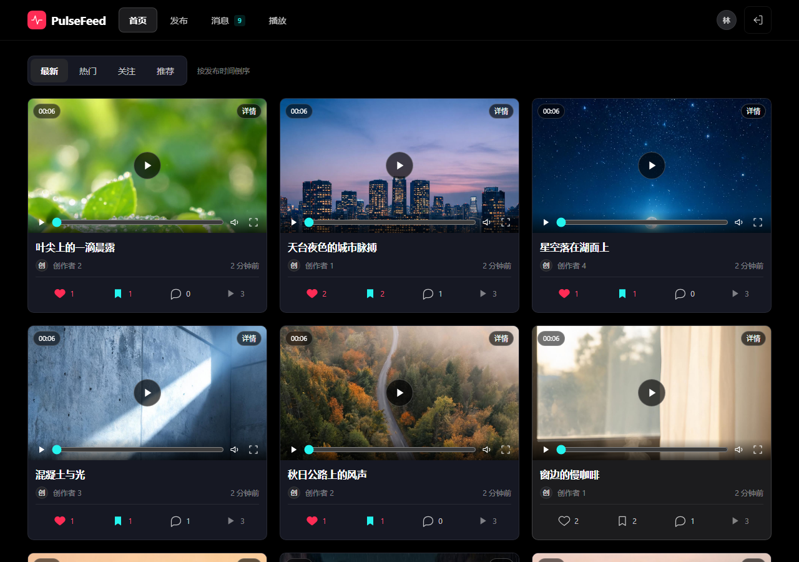
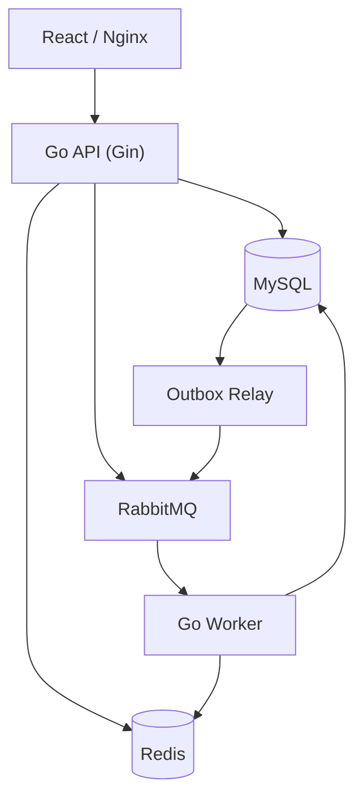
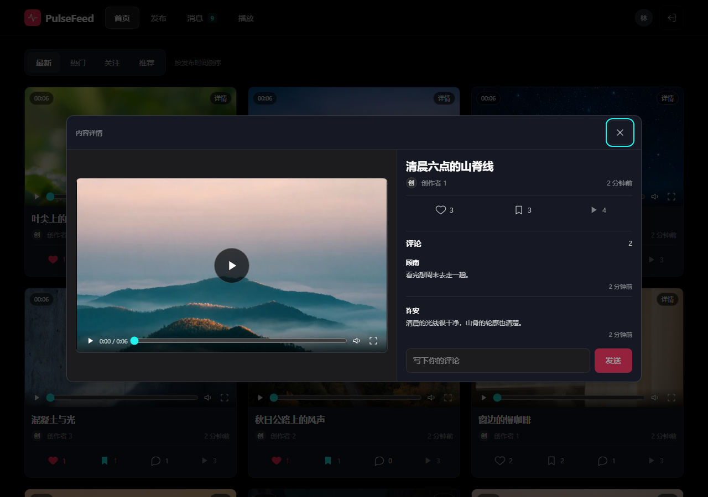
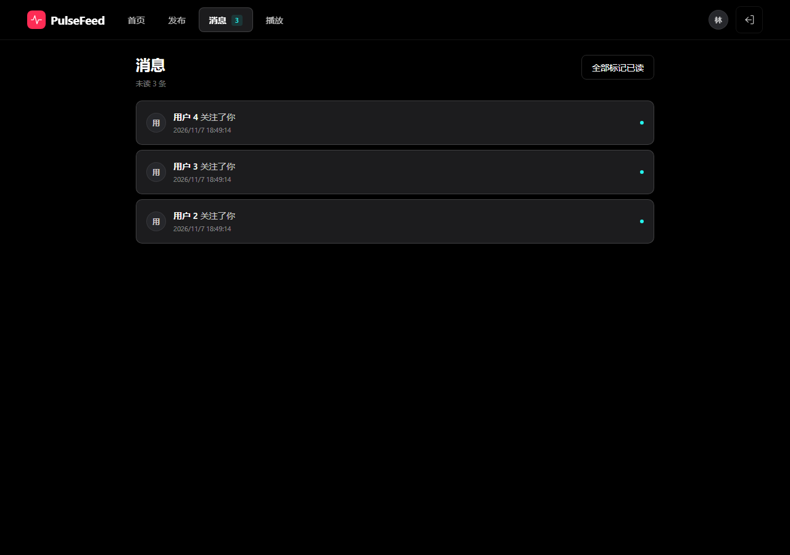

# PulseFeed

**面向短内容的 Go Feed 系统**，涵盖内容发布、四场景浏览、关注分发、互动、推荐与播放。参考 [GCFeed](https://github.com/LeoninCS/GCFeed) 进行学习型复现与工程实践。

[](https://go.dev/)
[](https://react.dev/)
[](https://www.mysql.com/)
[](https://redis.io/)
[](https://www.rabbitmq.com/)
[](https://github.com/waiting2050/PulseFeed/actions/workflows/ci.yml)



*截图来自此前实际运行版本，界面以当前代码为准。*

## 核心设计

| 问题 | 实现 |
|---|---|
| Feed 深分页与重复查询 | 复合游标、批量组装、分层缓存、singleflight |
| 关注流写放大 | 普通作者推粉丝 Inbox，大 V 写作者 Outbox，读取合并 |
| 热点互动 | Redis 计数分片、异步消费、按作品批量落库与同步回退 |
| 可靠消息 | 发布与播放事件支持事务 Outbox、confirm、重试和死信；消费者业务幂等 |
| 推荐与热榜 | 256 维 hash n-gram 向量、兴趣排序、分钟桶热度 |
| 媒体体验 | 大文件分片续传、媒体校验、播放预取与 QoS 上报 |

## 系统架构



API 处理 HTTP 请求，Worker 负责异步分发、互动落库和向量生成。播放事件与当日曝光聚合在 API 的数据库事务中完成；播放消费队列当前保留排空外壳，不再执行二次聚合补偿。

内部采用 `interfaces → application → domain` 依赖方向，`infra` 实现存储、缓存、消息等端口，通过组合根装配。

## 快速开始

需要 Docker 与 Docker Compose。克隆仓库后，在包含上述功能的开发分支上从根目录执行：

```bash
cd apps
cp .env.example .env
docker compose up -d --build
```

Windows PowerShell 可用 `Copy-Item .env.example .env` 替代 `cp`。

| 服务 | 地址 |
|---|---|
| Web | http://localhost:8088 |
| API 健康检查 | http://localhost:8090/health |
| RabbitMQ 管理台 | http://localhost:15673 |

打开 Web，注册账号、上传媒体并发布作品，再查看最新、热门、关注等 Feed。

可选监控：

```bash
docker compose --profile monitoring up -d prometheus grafana
```

Grafana 默认端口 3000，Prometheus 默认端口 19090。以上示例配置仅用于本地开发，部署到其他环境须替换默认凭据。完整配置、端口和测试方式见 [工程参考](docs/engineering-reference.md)。

## 功能展示

| 作品详情与播放 | 消息中心 |
|---|---|
|  |  |

## 工程结构

- `apps/api`：Go API、业务用例、领域模型、存储适配器和 Worker。
- `apps/web`：React + Vite，包含内容流、上传、消息、个人主页和播放器。
- `apps/monitoring`：Prometheus 和 Grafana 配置。
- `docs`：架构、接口、分片上传及工程参考。

## 测试与开发

```bash
cd apps/api
go build ./...
go vet ./...
go test ./...
# 配置真实 MySQL / Redis / RabbitMQ 后运行集成测试：
go test -tags=integration ./test/integration -v -count=1
```

```bash
# 从仓库根目录进入前端
cd apps/web
npm ci
npm run test
npm run build
```

CI 对后端执行 build/vet/test，对前端执行构建。前端 Feed 进度缓存另有 Node 内置测试。

## 已知限制与后续方向

- 目前是学习型复现项目，未承诺生产级吞吐量或高可用。
- Redis 与数据库异步写入仍存在一致性窗口，需要更完整的故障恢复和对账验证。
- 推荐是轻量文本向量基线，不是训练过的深度推荐模型。
- 媒体本地存储与多实例部署需要共享存储方案；K8s 清单未经集群级验证。
- 前端尚需补全端到端测试。

## 详细文档

- [架构与数据流](docs/architecture.md)
- [接口与端口](docs/routes-snapshot.md)
- [分片上传设计](docs/chunked-upload-design.md)
- [前端设计记录](docs/frontend-redesign.md)
- [完整工程参考](docs/engineering-reference.md)
